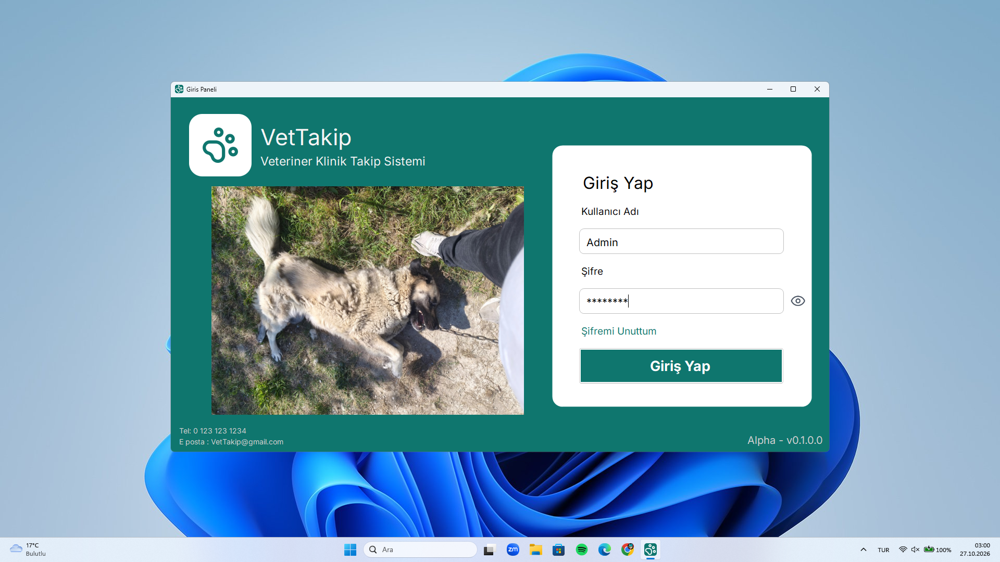
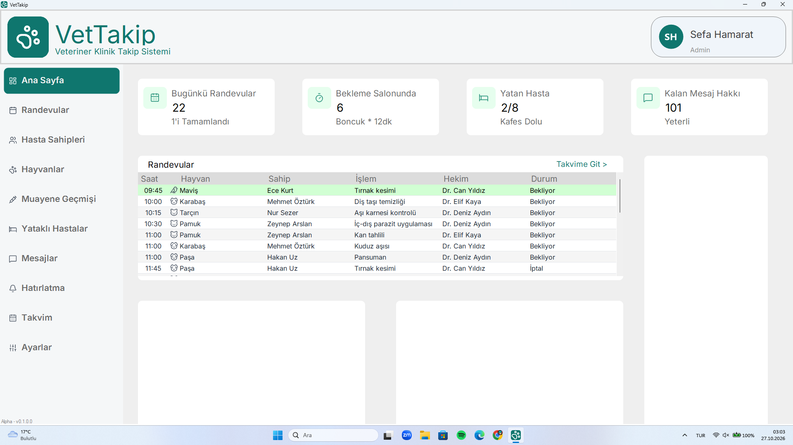
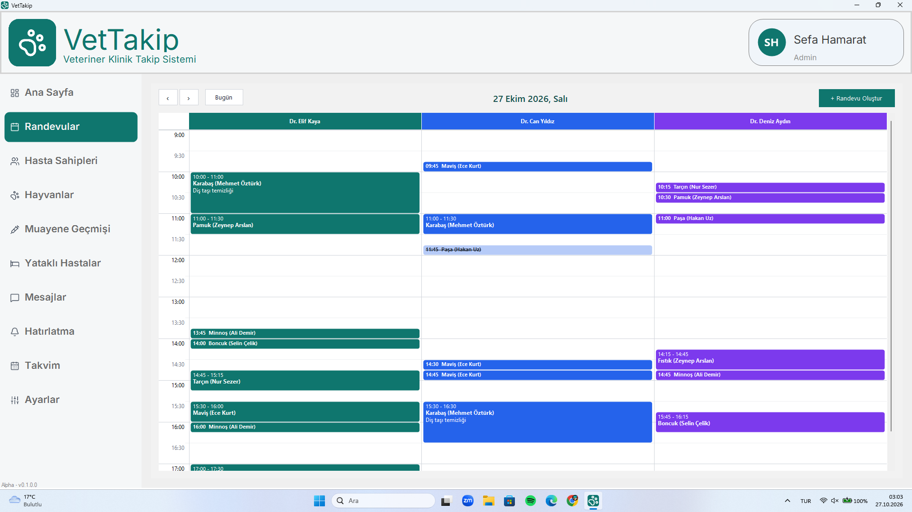
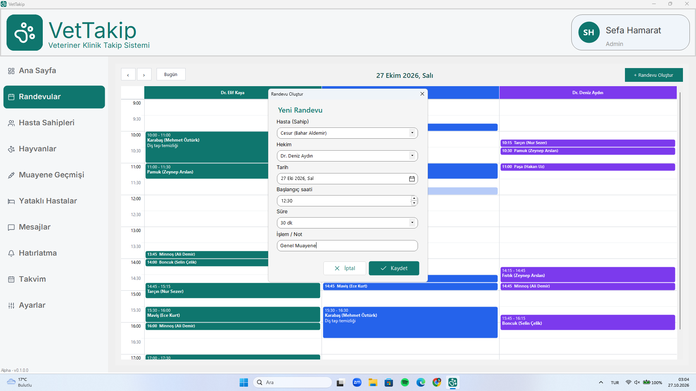
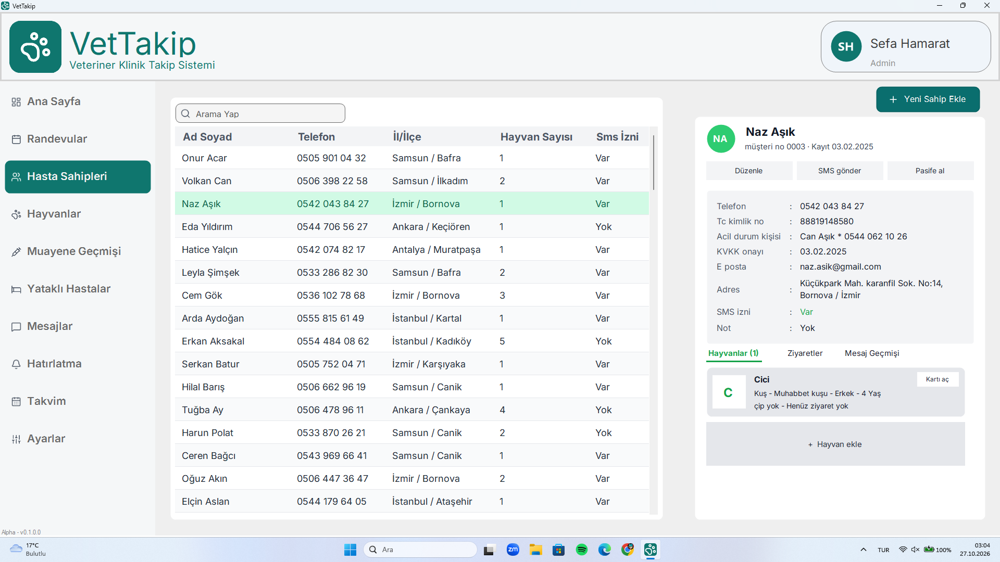
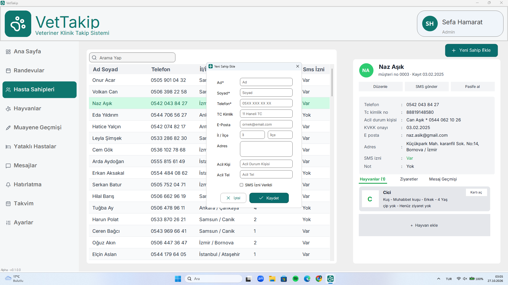
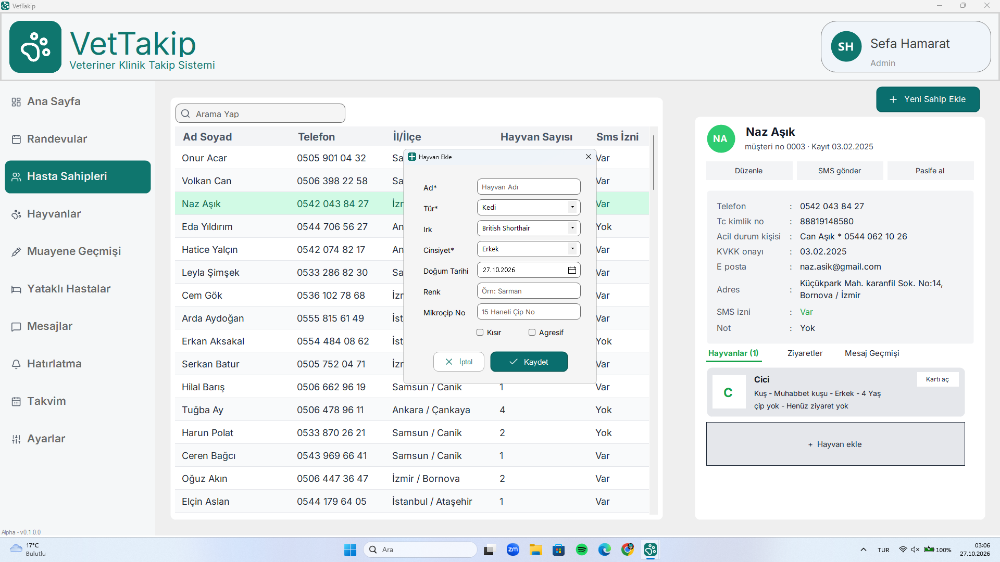

<div align="center">

  
# VetTakip

**Veteriner Klinik Takip Sistemi**

Randevuları, hasta sahiplerini ve hayvan kayıtlarını tek bir masaüstü uygulamasından yönetin.

🎓 *Üniversite dönem projesi olarak geliştirilmektedir.*

[](https://github.com/sefahmrt/VetTakip/releases)
[](https://dotnet.microsoft.com/download/dotnet-framework/net48)
[](https://learn.microsoft.com/dotnet/csharp/)
[](https://www.sqlite.org/)
[](#-kurulum)

[📥 İndir](#-indir) • [✨ Özellikler](#-özellikler) • [📸 Ekran Görüntüleri](#-ekran-görüntüleri) • [🚀 Kurulum](#-kurulum) • [🗄️ Veritabanı](#️-veritabanı) • [👥 Ekip](#-ekip)

</div>

---

## 📖 Hakkında

**VetTakip**, veteriner kliniklerinin günlük işleyişini kolaylaştırmak için geliştirilen bir Windows masaüstü uygulamasıdır. Günlük randevuları hekim bazlı takvimde görmenizi, hasta sahiplerinin ve hayvanlarının bilgilerini düzenli şekilde saklamanızı sağlar.

Bu proje, **Ondokuz Mayıs Üniversitesi Bafra MYO** **Bilgisayar Programcılığı** bölümü **Görsel Programlama-I** dersi kapsamında arkadaş grubumuzla birlikte geliştirilmektedir.

> ⚠️ **Not:** Proje şu anda **alpha** aşamasındadır. Bazı menüler henüz tamamlanmamıştır ve hatalarla karşılaşabilirsiniz.

## 📥 İndir

<div align="center">

[](https://github.com/sefahmrt/VetTakip/releases/download/v0.1-alpha/VetTakip.v0.1-alpha.zip)

</div>

1. Yukarıdaki bağlantıdan `.zip` dosyasını indirin.
2. Klasöre çıkarın.
3. Çalıştırılabilir (`.exe`) dosyaya çift tıklayın.

## ✨ Özellikler

### 🔐 Giriş
- Kullanıcı adı ve şifre ile giriş paneli
- Şifreyi göster/gizle seçeneği
- Rol bilgisi (Admin) ile oturum açma

### 📊 Ana Sayfa (Dashboard)
- **Bugünkü randevular** ve tamamlanan sayısı
- **Bekleme salonundaki** hasta sayısı ve ortalama bekleme süresi
- **Yatan hasta** doluluğu (kafes kapasitesi)
- **Kalan SMS (mesaj) hakkı**
- Günün randevularını saat, hayvan, sahip, işlem, hekim ve durum bilgisiyle listeleme

### 📅 Randevular
- Hekim bazlı sütunlarla **günlük takvim görünümü**
- Önceki / sonraki gün ve **"Bugün"** ile hızlı gezinme
- Yeni randevu oluşturma: hasta sahibi, hekim, tarih, başlangıç saati, süre ve işlem/not
- Randevu durumları (Bekliyor, İptal vb.) ve iptal edilen randevuların ayrı görünümü

### 👤 Hasta Sahipleri
- Sahip listesi: ad soyad, telefon, il/ilçe, hayvan sayısı ve SMS izni
- Arama yapma
- Yeni sahip ekleme: ad, soyad, telefon, TC kimlik, e-posta, il/ilçe, adres, acil durum kişisi ve SMS izni
- Sahip detay paneli: müşteri no, kayıt tarihi, KVKK onayı, not
- Düzenle, SMS gönder ve pasife alma işlemleri
- Sahibe ait **Hayvanlar**, **Ziyaretler** ve **Mesaj Geçmişi** sekmeleri

### 🐶 Hayvan Kayıtları
- Sahibin detay panelinden hızlıca hayvan ekleme
- Ad, tür, ırk, cinsiyet, doğum tarihi, renk ve mikroçip numarası
- Kısır ve agresif durum işaretleri
- Hayvan kartı ile yaş, ırk, çip ve ziyaret durumunu görüntüleme

## 📸 Ekran Görüntüleri

<div align="center">

| Giriş | Ana Sayfa |
|:---:|:---:|
|  |  |

| Randevular | Randevu Oluştur |
|:---:|:---:|
|  |  |

| Hasta Sahipleri | Yeni Sahip Ekle |
|:---:|:---:|
|  |  |

| Hayvan Ekle |
|:---:|
|  |

</div>

## 🛠️ Teknolojiler

| Katman | Teknoloji |
|---|---|
| Dil | C# |
| Arayüz | Windows Forms (özel `Radius*` yuvarlak köşeli kontroller) |
| Çatı | .NET Framework 4.8 |
| Veritabanı | SQLite ([System.Data.SQLite.Core](https://www.nuget.org/packages/System.Data.SQLite.Core) 1.0.119) |
| IDE | Visual Studio 2022 veya üzeri |

## 🚀 Kurulum

Projeyi kaynak koddan çalıştırmak için:

### Gereksinimler

- Windows 10 / 11
- [Visual Studio 2022](https://visualstudio.microsoft.com/) veya üzeri (**".NET masaüstü geliştirme"** iş yükü kurulu olmalı)
- .NET Framework 4.8 Developer Pack

### Adımlar

```bash
# 1. Depoyu klonlayın
git clone https://github.com/sefahmrt/VetTakip.git
```

2. `VetTakip.slnx` dosyasını Visual Studio ile açın.
3. Üst çubuktan platformu **x64** olarak seçin.
4. NuGet paketleri ilk derlemede otomatik yüklenir. **F5** ile çalıştırın.

> 💡 Veritabanı (`VetTakip/vettakip.db`) projeyle birlikte gelir ve her derlemede çıktı klasörüne (`bin\x64\Debug`) kopyalanır. Ek bir kurulum gerekmez.
>
> ℹ️ Proje klasik .NET Framework (WinForms) projesidir; `dotnet run` ile değil Visual Studio (veya MSBuild) ile derlenir.


## 📂 Proje Yapısı

```
VetTakip/
├── VetTakip/
│   ├── Panels/          # Ana sayfa, Sahipler, Randevular, Hayvan/Sahip ekleme ekranları
│   ├── Takvim/          # Hekim bazlı günlük randevu takvimi
│   ├── UserControls/    # Özel yuvarlak köşeli kontroller (RadiusButton, RadiusTextBox, ...)
│   ├── Resources/       # Simgeler ve görseller
│   ├── GirisForm.cs     # Giriş ekranı
│   ├── AnaForm.cs       # Ana pencere ve menü
│   ├── Veritabani.cs    # Ortak SQLite bağlantısı
│   └── vettakip.db      # SQLite veritabanı
├── docs/screenshots/    # README görselleri
├── VetTakip.slnx        # Visual Studio çözüm dosyası
└── README.md
```

## 🗺️ Yol Haritası

- [x] Giriş paneli
- [x] Ana sayfa (dashboard)
- [x] Randevu takvimi ve randevu oluşturma
- [x] Hasta sahibi yönetimi
- [x] Hayvan ekleme
- [ ] Hayvanlar sayfası
- [ ] Muayene geçmişi
- [ ] Yataklı hasta takibi
- [ ] Mesajlar (SMS gönderimi)
- [ ] Hatırlatma
- [ ] Takvim
- [ ] Ayarlar

## 👥 Ekip

| Üye | Rol | GitHub |
|---|---|---|
| **Sefa Hamarat** | Geliştirici | [@sefahmrt](https://github.com/sefahmrt) |
| **Yunus Emre Kirli** | Geliştirici | [@acemividyolar-alt](https://github.com/acemividyolar-alt) |
| **--** | Geliştirici | [@--](https://github.com) |

## 🤝 Katkıda Bulunma

1. Projeyi **fork**'layın
2. Yeni bir dal oluşturun: `git checkout -b ozellik/yeni-ozellik`
3. Değişikliklerinizi commit'leyin: `git commit -m "Yeni özellik eklendi"`
4. Dalı gönderin: `git push origin ozellik/yeni-ozellik`
5. Bir **Pull Request** açın

## 🐞 Hata Bildirimi

Bir hata mı buldunuz? [Yeni bir issue açın](https://github.com/sefahmrt/VetTakip/issues/new) ve hatanın açıklamasını, tekrar üretme adımlarını ve varsa ekran görüntüsünü ekleyin.

## 📄 Lisans

Bu proje için henüz bir lisans belirtilmemiştir.

---

<div align="center">

Projeyi beğendiyseniz ⭐ vermeyi unutmayın!

</div>
